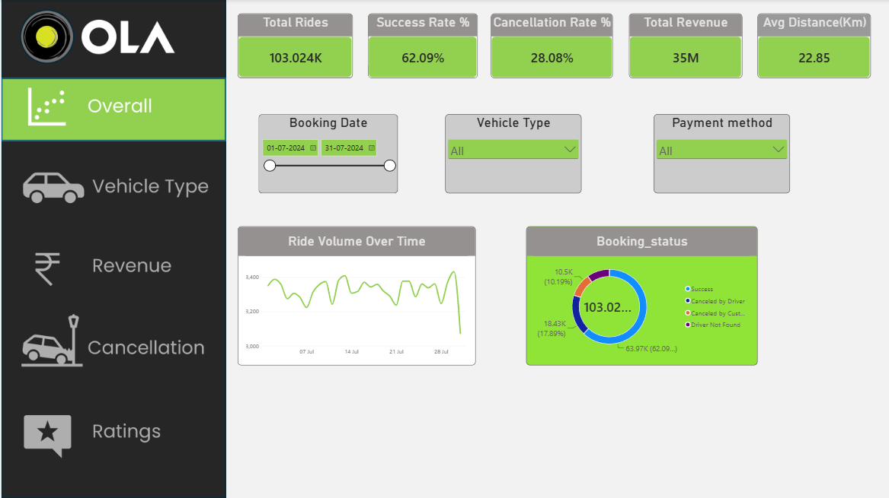
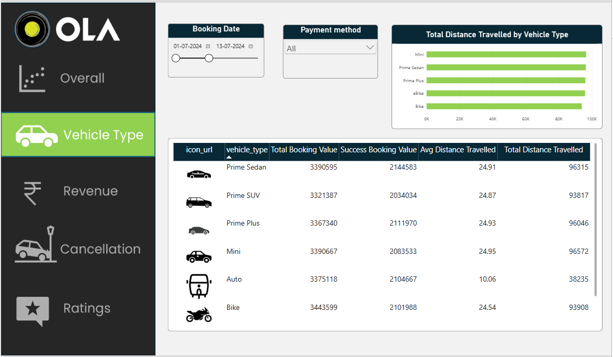
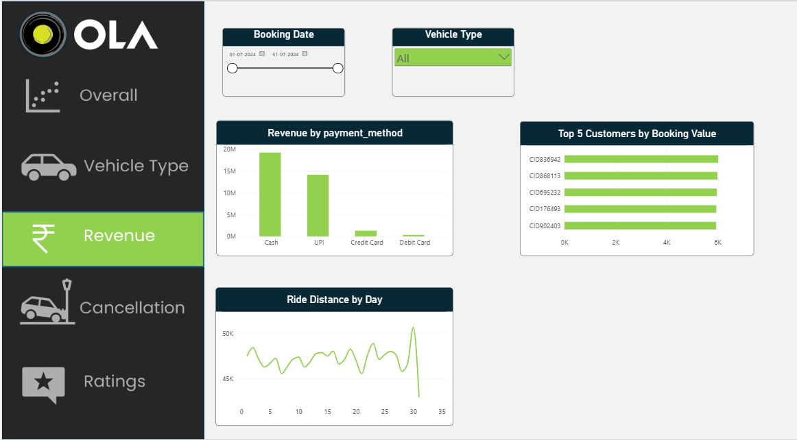
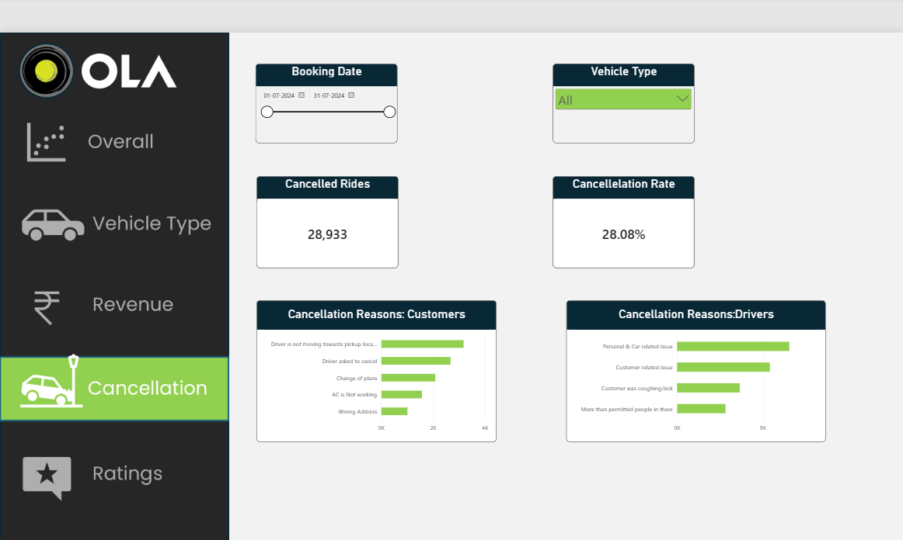
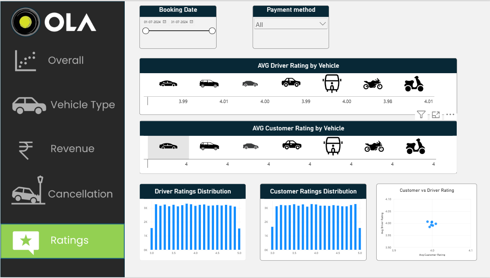

# Ola Ride Insights

An end-to-end analytics project on Ola ride bookings (July 2024): data cleaning in Python, business questions answered in SQL, an interactive Power BI dashboard, and a Streamlit app that brings it all together.

**Live app:** _add your Streamlit Community Cloud link here_

## Dataset

- 103,024 bookings from 1 to 31 July 2024, one row per booking (`Booking_ID` is unique).
- Booking status: Success 63,967, Canceled by Driver 18,434, Canceled by Customer 10,499, Driver Not Found 10,124.
- Seven vehicle types: Prime Sedan, Prime SUV, Prime Plus, Mini, Auto, Bike, E-Bike.
- Fields cover pickup and drop locations, booking value, ride distance, payment method, driver and customer ratings, and cancellation / incomplete-ride reasons.

## Tools

Python (pandas), PostgreSQL, Power BI, Streamlit, Git.

## Project structure

```
Ola_ride/
├── Notebooks/01_clean_ola.py       # cleaning script
├── Sql/Ola_ride_queries.sql        # table definition + the 10 queries
├── powerbi/Ola_ride.pbix           # Power BI dashboard
└── app/
    ├── app.py                      # Streamlit app
    ├── requirements.txt
    ├── data/ola_clean.csv          # cleaned data (used when no database is configured)
    └── powerbi/screenshots/        # dashboard screenshots shown in the app
```

## 1. Data cleaning

- Standardised column names and trimmed text.
- Dropped the `Time` column (the timestamp is already in `Date`) and the icon-URL column.
- **Missing values are structural, not errors.** Ratings, payment method and turnaround times exist only for successful rides, and cancellation or incomplete-ride reasons exist only for the matching case. Ratings and payment method were left as NULL so averages are correct; empty reason columns were labelled "Not Applicable".
- Cancelled rides still carry a booking value and a distance of 0, so revenue and average-distance figures always filter to successful rides.
- Added `hour`, `day_of_week`, `time_of_day`, `is_success` and `is_completed`.

## 2. SQL analysis

The cleaned data was loaded into PostgreSQL (`ola_db`, table `ola_rides`). The ten questions and their results:

| # | Question | Result |
|---|---|---|
| 1 | Successful bookings | 63,967 |
| 2 | Average distance per vehicle type | Auto ≈ 10.04 km; all others ≈ 25 km |
| 3 | Rides cancelled by customers | 10,499 |
| 4 | Top 5 customers by number of rides | CID954071 (5 rides), then four customers tied at 4 |
| 5 | Driver cancellations for personal and car issues | 6,542 |
| 6 | Max / min driver rating, Prime Sedan | 5.0 / 3.0 |
| 7 | Rides paid by UPI | 25,881 |
| 8 | Average customer rating per vehicle type | ≈ 4.0 for every type |
| 9 | Total booking value of successful rides | ₹35,080,467 |
| 10 | Incomplete rides and reason | 3,926 rides |

Notes: Q4 has ties at the cut-off, so a customer-ID tie-breaker is used. Q9 counts all rides with status Success; excluding the 3,926 rides flagged incomplete is a stricter alternative (included as a comment in the SQL file).

## 3. Power BI dashboard

Five pages with a shared Ola-branded layout and sidebar navigation:

1. **Overall:** total rides, success rate, cancellation rate, revenue, average distance, ride volume over time, booking status breakdown.
2. **Vehicle Type:** total and successful booking value, average and total distance per vehicle, top 5 vehicle types by distance.
3. **Revenue:** revenue by payment method, top 5 customers by booking value, daily ride distance.
4. **Cancellation:** cancellation reasons for customers and for drivers.
5. **Ratings:** average driver and customer rating per vehicle, rating distributions, customer vs driver rating.

_Add your screenshots here, for example:_

```





```

## 4. Streamlit app

- **SQL Insights:** pick any of the ten questions, see the SQL and its result.
- **Ride Explorer:** filter by vehicle type, status, payment method and date, search by booking or customer ID, and download the filtered data.
- **Power BI Dashboard:** the dashboard pages.

The app reads from PostgreSQL when credentials are present in `.streamlit/secrets.toml`, and otherwise falls back to `data/ola_clean.csv`, so it also runs when deployed.

### Run locally

```
cd app
pip install -r requirements.txt
streamlit run app.py
```

To use PostgreSQL, create `.streamlit/secrets.toml`:

```
[postgres]
host = "localhost"
port = 5432
database = "ola_db"
user = "postgres"
password = "YOUR_PASSWORD"
```

This file is excluded from Git; never commit it.

## Key insights

- **Only 62.1% of bookings succeed.** 28.1% are cancelled (28,933 rides) and about 10% end with no driver found.
- **Drivers cancel more than customers:** 18,434 against 10,499. The top driver reason is personal and car-related issues (6,542).
- **Customers mostly cancel because the driver isn't moving towards pickup** (3,175), followed by the driver asking them to cancel (2,670). Both are driver-side problems.
- **Cash is about 55% of successful revenue and UPI about 40%.** Cards together are under 5%.
- **Autos average about 10 km per ride against about 25 km for every other vehicle type,** so Autos are a short-distance product.
- **Ratings don't separate vehicle types.** Average driver and customer ratings are about 4.0 for all seven, and success rates are within 61.4% to 63.0%.
- **Demand is flat through the day,** at about 4,200 to 4,400 rides every hour, with no clear peak.
- Of successful rides, 3,926 (6.1%) are flagged incomplete, mostly for customer demand (1,601) or vehicle breakdown (1,591).

## Possible next steps

- Investigate why drivers cancel, for example by pickup location and time.
- Model the likelihood of a cancellation from booking features.
- Refresh the dashboard from the database on a schedule.
